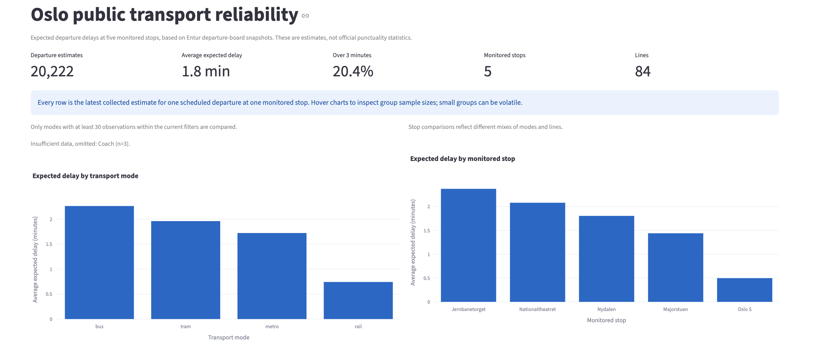

# Norwegian Public Transport Analytics

An end-to-end data analytics portfolio project using publicly available departure information from **Entur**. It combines Python, PySpark, PostgreSQL and Streamlit to explore patterns in expected public transport delays at five selected Oslo stops.

## Project overview

The goal is to turn recurring real-time departure snapshots into a dataset that can be analysed over time. The dashboard explores how expected delays vary between transport modes, stops, lines and times of day.

This is an exploratory analytics case, not a passenger-facing alternative to Ruter or Entur.

## Dashboard preview

The Streamlit dashboard lets users filter by date, stop, transport mode and line.

## Key findings

The recorded sample covers **3–8 September 2026**, with **20,222 distinct departure estimates at five monitored stops** across 84 lines. Each logical departure is counted once per monitored stop. The figures come from the [analytical SQL](sql/business_analysis.sql).

| Mode | Estimates (n) | Mean expected delay | Median | Over 3 minutes |
| --- | ---: | ---: | ---: | ---: |
| Bus | 8,996 | 135.9 sec | 90 sec | 26.3% |
| Tram | 2,643 | 117.7 sec | 90 sec | 23.7% |
| Metro | 5,399 | 103.4 sec | 69 sec | 17.0% |
| Rail | 3,181 | 44.6 sec | 0 sec | 6.9% |

Three additional coach estimates are omitted from the comparison because the sample is too small.

- **Buses had the highest mean expected delay** among the main transport modes in this sample.
- **16:00 and 17:00 had the highest hourly means**, at 163.1 and 151.1 seconds respectively.
- **Jernbanetorget had the highest mean** among the five monitored stops, at 142.3 seconds (n=6,067).
- **Some lines showed a high share of estimates over three minutes late**, including bus 54 (55.0%, n=262) and bus 81 (49.7%, n=680).

These results describe a limited sample of *expected* departure times, not verified actual departures or the entire Oslo network.

## Data pipeline

\`\`\`text
Entur APIs → Python collection → raw JSON
           → PySpark transformation → Parquet
           → PostgreSQL data model and SQL views
           → Streamlit dashboard (Pandas + Plotly)
\`\`\`

1. **Collect:** Python retrieves upcoming departures from Entur's Journey Planner API. The collection runner supports repeated snapshots at five-minute intervals.
2. **Transform:** PySpark parses the nested responses, standardises timestamps, calculates expected delay and writes processed Parquet files.
3. **Store:** PostgreSQL holds stop, line and date dimensions alongside departure observations. SQL creates reusable analytical views.
4. **Visualise:** Streamlit and Plotly display the metrics and comparisons with interactive filters.

### An important data-quality decision

The same departure can appear in several API snapshots. Counting every snapshot as a separate departure would distort the analysis. The [latest-estimate SQL view](sql/create_analytics_views.sql) keeps the most recent recorded estimate for each logical departure at each stop.

In the September sample, approximately **34,000 recorded observations** were reduced to **20,222 latest departure estimates** for analysis. The pipeline also checks identifiers, timestamps and duplicate records.

## Run locally

**Requirements:** Python 3.11 or 3.12, a Java runtime compatible with PySpark, and PostgreSQL with the \`psql\` client. The commands below use a macOS/Linux-style shell and run from the repository root.

Install the project and configure \`.env\` with your Entur client identifier and local PostgreSQL settings:

\`\`\`bash
python3.12 -m venv .venv
.venv/bin/python -m pip install -e ".[dev]"
cp .env.example .env
\`\`\`

Create the database and initialise the schema (replace the example PostgreSQL username if needed):

\`\`\`bash
createdb -h localhost -p 5432 -U your_local_postgres_user transport_analytics
psql -h localhost -p 5432 -U your_local_postgres_user \
  -d transport_analytics -f sql/create_schema.sql
\`\`\`

Collect a snapshot, refresh the pipeline and start the dashboard:

\`\`\`bash
.venv/bin/python -m transport_analytics.ingestion.collection_runner
.venv/bin/refresh-transport-pipeline
.venv/bin/streamlit run dashboard/app.py
\`\`\`

For recurring collection, run \`.venv/bin/python -m transport_analytics.ingestion.collection_runner --repeat --interval-seconds 300\` separately. New collections will produce different results from the September sample. Raw JSON and processed Parquet files are excluded from Git.

## Methodology and limitations

**Expected delay = expected departure time − aimed departure time.** Positive values indicate an expected late departure; “over three minutes” means more than 180 seconds. Dates and hours are based on Oslo local time.

The sample covers only six calendar dates and five selected stops. Collection gaps, different service mixes and estimates that may change before departure limit the conclusions. It is not an official punctuality measure or a causal comparison of routes.

## Tests and code

The repository includes tests for API handling, PySpark transformation, database logic and dashboard queries. Run checks from the project root:

\`\`\`bash
.venv/bin/ruff check .
.venv/bin/pytest
.venv/bin/python -c "import dashboard.app"
\`\`\`

Explore the [pipeline code](src/transport_analytics/), [SQL data model](sql/create_schema.sql), [business queries](sql/business_analysis.sql) or [dashboard](dashboard/app.py) for implementation details.
